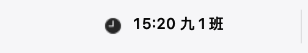
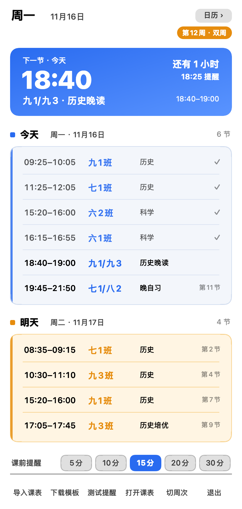
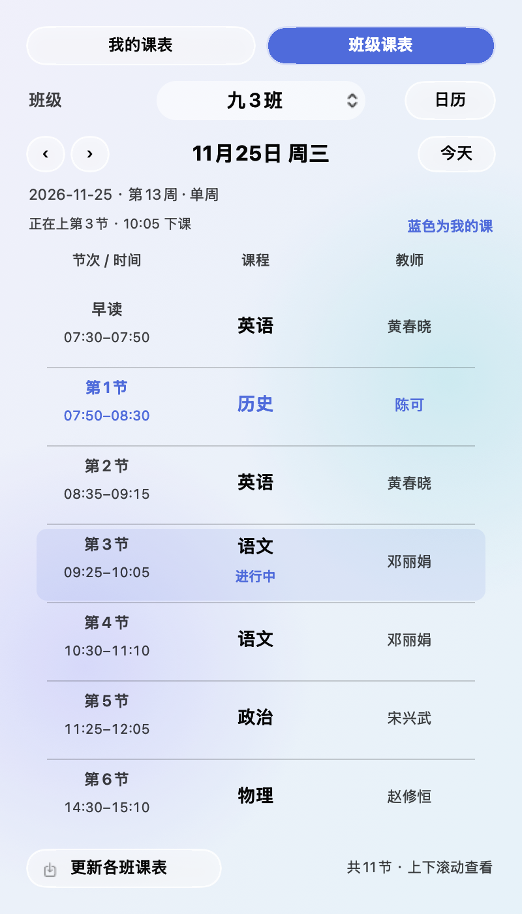
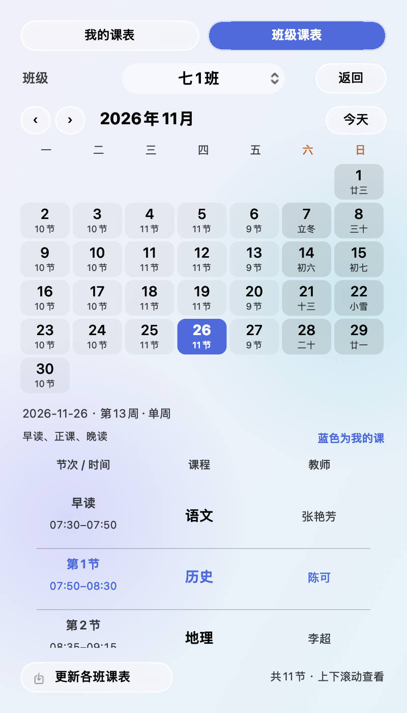

<p align="center"></p>

<h1 align="center">上课提醒 · ClassReminder</h1>

<p align="center">
  <a href="../../releases/latest"></a>
  
  
  
  <a href="LICENSE"></a>
</p>

<p align="center">
  一节课快开始时，在屏幕<strong>右上角</strong>弹出一张大卡片，连响三声，再用中文女声念：<br>
  <strong>「九三班历史课，11点25分上课，还有15分钟」</strong>
</p>

<p align="center">
  写给一线老师的 macOS 菜单栏工具 · 个人上课提醒 + 各班课表查询<br>
  原生 Swift，课表本地保存，在线语音不可用时回退系统语音
</p>

## 📸 界面

<p align="center"><br>
<sub>菜单栏：时钟图标 + 下一节「时间 + 班级」</sub></p>

<p align="center"><br>
<sub>我的课表：下一节、今天与明天课表，保留个人提醒与导入功能</sub></p>

<p align="center"><br>
<sub>班级课表：蓝字标记我的课；浅蓝底与「进行中」标记当前课程（11月25日09:30演示）</sub></p>

<p align="center"><br>
<sub>班级日历：选择班级与日期，查看早读、正课、晚读和教师</sub></p>

<p align="center"><br>
<sub>提前 15 分钟：蓝色卡片 + 三连响 + 语音播报</sub></p>

<p align="center"><br>
<sub>到点：大卡片再提醒一次，响三声、不语音</sub></p>

## v1.13.5 新增了什么

本次发布汇总 v1.13.0–v1.13.5 的更新，原有个人提醒功能保留。

| 新功能 | 使用方式 |
|---|---|
| 两种课表模式 | 顶部切换「我的课表 / 班级课表」 |
| 各班完整课程 | 选择班级，按时间查看早读、正课和晚读，显示科目与教师 |
| 日期与月历查询 | 左右切换日期，或进入日历选日；切换班级保留日期 |
| 我的课用蓝字 | 按个人课表的班级、时间、科目与单双周匹配，支持合班早晚读 |
| 当前课程用浅蓝底 | 查看今天时显示当前节次、下课时间及「进行中」，每15秒检查更新 |
| 稳定的面板布局 | 两个主页面同宽同高，班级日历向右展开完整课表，底部操作固定 |
| 独立更新各班课表 | 导入同结构的学校 xlsx，不覆盖个人课表、不增加个人提醒 |

已内置七1、八1、八2、九1、九2、九3共六个班的示例安排。查询更早的学期内日期时，会注明按当前版本课表参考；历史实际调课需以对应旧版课表为准。

## ✨ 功能

- 🕘 **菜单栏常驻**：不占 Dock，点一下就是课表
- ⏰ **提前提醒**：从下方菜单选择 5 / 10 / 15 / 20 / 30 分钟，立即生效
- 🔔 **两次提醒**：提前 N 分钟蓝色卡片 + 语音；到点大卡片再响三声，不语音
- 🔊 **叫得住人**：大卡片置顶 + 连响三次 + 中文女声播报两遍
- 📅 **万年历**：1900–2100 任意年月都能翻，每格带农历 / 节气；学期内标出当天课量
- 🔴 **课型配色**：正课（历史、科学）红点 + 红色班名，早读 / 晚读 / 晚自习 / 培优蓝点
- 🟡 **周末区分**：周六周日表头用暖色，格子上加一层淡暖底，一眼看出工作日和周末
- ⚙️ **学期设置**：学期开始日、周数、第 1 周是单周还是双周，面板里直接改，立刻生效
- 🗓 **单双周**：按「第 1 周是哪天、那天算单周还是双周」自动推算，可手动切换
- 🎨 **今天 / 明天区分**：今天用暖杏色卡片，明天用青绿色卡片；下一节用深蓝渐变突出
- 📥 **CSV 导入**：App 里下模板，填好导进来，立刻生效
- 🚀 **开机自启**：写一个 LaunchAgent，重启后自动回来

## 📦 安装

1. 到 [最新发布页](https://github.com/chinachenkeke-source/class-reminder/releases/latest) 下载 `ClassReminder-1.13.12.dmg`（也提供 zip）
2. 双击挂载，把 `上课提醒.app` 拖进「应用程序」
3. 第一次打开被拦，就在 App 上右键 →「打开」（没有开发者签名）

| 内容 | 位置 |
|---|---|
| 课表数据 | `~/Library/Application Support/ClassReminder/timetable.json` |
| 各班课表数据 | `~/Library/Application Support/ClassReminder/school-timetable.json`（更新各班课表后生成） |
| 运行日志 | `~/Library/Logs/ClassReminder.log` |
| 开机自启 | `~/Library/LaunchAgents/com.mac.classreminder.plist` |

升级：退出旧版后用新版替换「应用程序」里的 App，个人课表和提醒偏好会保留。

卸载：面板里点「退出」，再删除上表列出的数据、日志、自启项和「应用程序」里的 App。

## 🖱 怎么用

### 班级课表查询

顶部「我的课表 / 班级课表」切换模式。班级课表中选择班级，再用左右箭头查前后一天，或进入「日历」点击日期。切换班级保留日期，班级选择会记住；课程列表可上下滚动，包含早读、正课、晚读及教师姓名。

班级课表及日历详情中，属于个人课表的课程显示蓝色文字。按当天班级、单双周、时间与科目匹配，也支持合班早晚读。查看今天时，当前正在上的课程显示浅蓝底和「进行中」，顶部提示当前节次；随上课、下课时间自动更新，保留列表滚动位置。

两个主页面共用固定面板尺寸（按屏幕可用高度适配），底部操作固定，课程多时列表内部滚动。班级日历向右展开：右侧显示选中日期的完整班级课表，日历下方只显示自己在该班当天的课程，没有则提示「当天没有我的课」。班级、日期标题居中，完整课表按节次与时间、课程、教师三列展示。

班级课程内容与手机版对齐：补充第9节 17:05–17:45「培优」，在第4节、第6节和晚读前分别插入大课间、午休、晚餐。大课间为10:05–10:30（周五至10:15），午休为12:05–14:30，晚餐为17:45–18:40；今天的实时状态也会显示对应休息时段及结束时间。休息时段不计入课程节数。

早读使用绿色与淡绿底，晚读使用紫色与淡紫底；属于个人课表的课程文字仍为蓝色，正在上的课程仍用浅蓝底和「进行中」标记。

班级日历的日期格左上角红色斜角标表示「我有正课或培优」，右上角蓝点表示「我有早读或晚读」，同一天可同时显示两种标记。选中日期时标记加白色描边；悬停日期可查看班级课量及个人各类课程数量。

已内置 2026-11-25 起生效的初中部六个班课表。七1班周四第1节、八2班周五第2节，按已确认的个人课表显示：单周历史（陈可）、双周政治（肖婷）。其他组合科目完整保留；早晚读按原表单双周安排匹配，周次采用现有学期设置。生效日期前也可按当前课表查询，界面会标注版本参考；学期外不显示课程。

「更新各班课表」支持与本次学校总表同结构的 xlsx（含「班级总课表」「早晚读」两页，标题含生效年月日），不要求改填个人课表模板。人数页不导入。各班数据独立保存在 `~/Library/Application Support/ClassReminder/school-timetable.json`，不会加入个人提醒；未更新时使用 App 内置数据。

### 我的课表

- **看课表**：点菜单栏图标，弹出的面板里是下一节、今天、明天
- **调提前量**：面板底部点当前提醒时间，选择 5 / 10 / 15 / 20 / 30 分钟
- **导课表**：底部点「导入课表」；需要空白模板时，点「更多」→「下载课表模板」
- **周次不对**：点「更多」→「切换单双周」
- **试听效果**：点「更多」→「测试提醒」，用你真实的下一节课演示一遍
- **学期设置**：点右上角「设置」

## 📝 课表格式

数据存在 `timetable.json`，也可以直接改它：

```json
{
  "weekAnchor": "2026-08-31",
  "anchorIsOdd": true,
  "leadMinutes": 10,
  "skipDates": ["2026-11-20"],
  "lessons": [
    {
      "weekday": 4, "period": 2,
      "start": "08:35", "end": "09:15",
      "klass": "八2班", "subject": "历史"
    },
    {
      "weekday": 4, "period": 1,
      "start": "07:50", "end": "08:30",
      "klass": "七1班", "subject": "历史",
      "weeks": "odd"
    }
  ]
}
```

| 字段 | 说明 |
|---|---|
| `weekday` | 1 到 7，1 是周一 |
| `period` | 1 到 13 表示第几节；0 表示早读 / 晚读 |
| `weeks` | `odd` 单周、`even` 双周、不写就是每周 |
| `weekAnchor` | 第 1 周的周一是哪天 |
| `anchorIsOdd` | 第 1 周算单周还是双周 |
| `skipDates` | 放假、调休的日期，那天完全不提醒 |

## 📥 用自己的课表（导入）

面板里点「更多」→「下载课表模板」，得到 `课表模板.xlsx`，里面两页：

| 工作表 | 干什么用 |
|---|---|
| 填写说明 | 三句话看懂 + 每列怎么填 + 单双周怎么填 + 例子 |
| 课表 | 只有表头，**星期 / 节次 / 周次 都是下拉选择**，填 200 行不用记格式 |

填完回 App 点「导入课表」选这个文件，菜单栏和提醒立刻换成你的课表。

**单双周是可选的**，不是所有人都有：

- 学校不分单双周 → 周次全选「每周」，或者**留空**（留空 = 每周都上）
- 单周、双周上的课不一样 → 同一节填两行，一行「单周」一行「双周」

也支持 CSV：同样的七列，用 Excel 另存为 CSV 再导入一样能用。

## 🗂 目录结构

```
Sources/main.swift    个人课表逻辑 / 菜单栏 / 面板 / 提醒 / CSV·xlsx 导入
Sources/SchoolSchedule.swift  各班总课表解析、独立数据和查询界面
school-timetable.json  内置的学校各班课表（含早晚读）
Info.plist            App 信息（LSUIElement = 菜单栏模式）
timetable.json        示例课表，首次运行会复制成用户数据
课表模板.xlsx          空白模板（带下拉选择）
课表示例.csv           填好的 CSV 例子（27 条）
build.sh              一键编译 + 安装
preview.png           面板截图
preview-school.png    班级当日课表与当前课程演示
preview-school-calendar.png  班级月历与课程详情
preview-alert.png     提前提醒截图（蓝）
preview-alert-start.png  到点提醒截图（琥珀）
statusbar.png         菜单栏示意
AppIcon.icns          应用图标（读入 .app 用）
AppIcon.png           图标 1024 原图（无 alpha，打进 .app）
AppIcon-rounded.png   带圆角的展示版（README 用）
tools/make-icon.py    生成图标的脚本
tools/make-template.py 生成 xlsx 模板的脚本
tools/check-school.sh  班级课表解析、查询与布局检查
tests/SchoolScheduleChecks.swift  班级课表验证用例
CHANGELOG.md          更新日志
dist/                 本地打包好的 dmg / zip（不入库）
exports/              导出的课表与备份（不放桌面，不入库）
promo/                宣传图与推广文案（不入库）
```

> 仓库里只放源码和文档；`dist` `exports` `promo` 三个目录是本地用的，已在 `.gitignore` 里忽略。

## 🔧 从源码构建

需要 Xcode Command Line Tools（有 `swiftc` 就行）：

```bash
./build.sh 1.13.5   # 带版本号：写进 Info.plist，产物也带版本号
./build.sh          # 不带就沿用现有版本
```

一次做完五件事：

1. 把版本号写进 `Info.plist`（`CFBundleShortVersionString` + `CFBundleVersion`）
2. 编译 + 临时签名
3. 打包 `dist/ClassReminder-<版本>.dmg` / `.zip`
4. 在 `dist/backups/` 存一份 `上课提醒-<版本>.app`
5. 装到 `/Applications`，写好 LaunchAgent 并启动

**版本规矩**：每次改动都升版本号，App / dmg / zip / 备份包四处一致；`dist/` 与 `dist/backups/` 只保留最近 5 个版本，更老的自动清掉。

图标由 `tools/make-icon.py` 生成（蓝底白表盘 + 琥珀提醒点），改完跑一遍再 `./build.sh` 即可。
首次运行会把仓库里的 `timetable.json` 复制成你的数据；之后改仓库那份**不会**覆盖你在用的，要手动 `cp` 过去。

## 💻 命令行

```bash
ClassReminder --dump             # 打印未来 8 天课表
ClassReminder --parse x.csv      # 只校验 CSV / xlsx 能不能读懂
ClassReminder --template o.xlsx  # 生成一份空白模板
ClassReminder --dumprows x.xlsx  # 打印解析出来的每一行，排查用
ClassReminder --import x.csv     # 无界面导入
ClassReminder --voice            # 看当前用的中文嗓音
ClassReminder --shot out.png     # 渲染面板预览图
ClassReminder --shotalert o.png  # 渲染「提前」提醒预览图
ClassReminder --shotstart o.png  # 渲染「到点」提醒预览图
ClassReminder --teststart        # 立刻弹一个到点提醒（试样式）
ClassReminder --shotbar o.png    # 渲染菜单栏示意
ClassReminder --shotschool o.png --date 2026-11-25  # 渲染班级课表
ClassReminder --shotschool o.png --calendar --date 2026-11-25  # 渲染班级日历
ClassReminder --convert-school 学校总课表.xlsx school-timetable.json  # 转换同结构学校总表
```

班级查询检查（不会启动提醒或修改使用中的个人课表）：

```bash
bash tools/check-school.sh
# 可选：校验学校原始 xlsx，并输出界面预览到已存在的目录
bash tools/check-school.sh 学校总课表.xlsx /tmp/class-reminder-previews
```

## 🚧 已知限制

- 没有开发者证书，系统通知发不出去，于是改成「置顶窗口 + 声音 + 语音」，反而不受勿扰模式影响。
- 音量上限就是系统音量。系统音量很低时声音也小，但窗口一定出现在右上角最前面。
- 语音优先使用在线神经网络女声（edge-tts 晓晓）；断网、环境缺失或合成失败时，自动回退系统自带 `say`（Tingting）。

## 🗒 更新日志

完整记录见 [CHANGELOG.md](CHANGELOG.md)。

- **v1.13.6**（2026-11-26）：班级课表与手机版对齐，补齐大课间、午休、晚餐和第9节培优
- **v1.13.5**（2026-11-25）：当前课程浅蓝底、个人课程蓝字，随时间自动更新
- **v1.13.4**（2026-11-25）：主页面统一尺寸，班级和日期居中，课程三列对齐
- **v1.13.3**（2026-11-25）：班级查询增加个人课程识别
- **v1.13.2**（2026-11-25）：支持按当前课表参考查询更早的学期内日期
- **v1.13.1**（2026-11-25）：确认两处共用正课的历史／政治单双周安排
- **v1.13.0**（2026-11-25）：新增六个班的当日与日历课表查询，早读、正课、晚读统一展示

- **v1.12.0**（2026-11-17）：语音改为在线神经网络女声（晓晓），断网自动回退系统语音
- **v1.11.1**（2026-11-16）：日历详情里的班名也跟着课型变红/变蓝
- **v1.11.0**（2026-11-16）：日历区分工作日与周末（表头暖色 + 淡暖底）
- **v1.10.1**（2026-11-16）：日历圆点全部显示，不再只显示 3 个
- **v1.10.0**（2026-11-16）：日历按课型分色（正课红、早读晚读晚自习培优蓝）
- **v1.9.0**（2026-11-16）：日历可翻任意年份（1900–2100），不再限制在学期内
- **v1.8.0**（2026-11-16）：日历加农历与节气（万年历）
- **v1.7.0**（2026-11-16）：新增学期设置（开始日 / 周数 / 第 1 周单双），日历跟着走
- **v1.6.0**（2026-11-16）：新增日历视图（按天看课，限定本学期 22 周）
- **v1.5.1**（2026-11-05）：周次下拉去掉「单双周」
- **v1.5.0**（2026-11-05）：课表模板改成 xlsx（带下拉选择），支持直接导入
- **v1.4.4**（2026-11-05）：到点提醒改成响三声
- **v1.4.3**（2026-11-05）：测试连播间隔改成 15 秒
- **v1.4.2**（2026-11-05）：测试连播间隔改成 10 秒
- **v1.4.1**（2026-11-05）：测试提醒连播两种样式
- **v1.4.0**（2026-11-05）：到点再提醒一次（琥珀卡片，不语音）
- **v1.3.0**（2026-11-05）：图标重画（立体表盘），README 改用圆角展示版
- **v1.2.1**（2026-11-05）：修掉图标外面的灰底板
- **v1.2.0**（2026-11-05）：新增 App 图标
- **v1.1.1**（2026-11-05）：修正第 5 节课时间（11:25–12:05）
- **v1.1.0**（2026-11-05）：CSV 导入与模板、提醒卡片改版、提前分钟可选、菜单栏图标
- **v1.0.0**（2026-11-04）：首个版本，菜单栏面板、单双周、课前提醒、语音播报

## 📄 许可

[MIT](LICENSE) © 2026 陈可可 (Chen Keke) —— 随便用、改、商用，保留版权声明即可。
