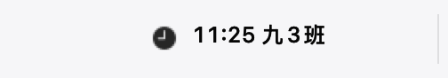
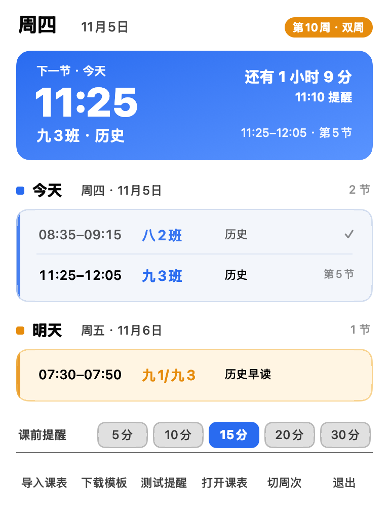

<p align="center"></p>

<h1 align="center">上课提醒 · ClassReminder</h1>

<p align="center">
  <a href="../../releases/latest"></a>
  
  
  
  <a href="LICENSE"></a>
</p>

<p align="center">
  一节课快开始时，在屏幕<strong>右上角</strong>弹出一张大卡片，连响三声，再用中文女声念：<br>
  <strong>「九三班历史课，11点25分上课，还有15分钟」</strong>
</p>

<p align="center">
  写给一线老师的 macOS 菜单栏工具 · 支持单双周课表、CSV 导入、开机自启<br>
  单文件 Swift，零第三方依赖，不联网
</p>

## 📸 界面

<p align="center"><br>
<sub>菜单栏：时钟图标 + 下一节「时间 + 班级」</sub></p>

<p align="center"><br>
<sub>面板：下一节倒计时、今天（蓝灰）、明天（琥珀）</sub></p>

<p align="center"><br>
<sub>课前提醒：置顶在所有窗口之上</sub></p>

## ✨ 功能

- 🕘 **菜单栏常驻**：不占 Dock，点一下就是课表
- ⏰ **提前提醒**：5 / 10 / 15 / 20 / 30 分钟，点一下即生效
- 🔊 **叫得住人**：大卡片置顶 + 连响三次 + 中文女声播报两遍
- 🗓 **单双周**：按「第 1 周是哪天、那天算单周还是双周」自动推算，可手动切换
- 🎨 **今天 / 明天分色**：蓝灰对琥珀，不会看混
- 📥 **CSV 导入**：App 里下模板，填好导进来，立刻生效
- 🚀 **开机自启**：写一个 LaunchAgent，重启后自动回来

## 📦 安装

1. 到 Releases 下载 `ClassReminder-1.3.0.dmg`
2. 双击挂载，把 `上课提醒.app` 拖进「应用程序」
3. 第一次打开被拦，就在 App 上右键 →「打开」（没有开发者签名）

| 内容 | 位置 |
|---|---|
| 课表数据 | `~/Library/Application Support/ClassReminder/timetable.json` |
| 运行日志 | `~/Library/Logs/ClassReminder.log` |
| 开机自启 | `~/Library/LaunchAgents/com.mac.classreminder.plist` |

卸载：面板里点「退出」，再删掉上表三项和「应用程序」里的 App。

## 🖱 怎么用

- **看课表**：点菜单栏图标，弹出的面板里是下一节、今天、明天
- **调提前量**：面板底部「课前提醒」里点 5 / 10 / 15 / 20 / 30，立刻生效并记住
- **导课表**：底部「下载模板」→ 填好 →「导入课表」，菜单栏和提醒立刻换成新课表
- **周次不对**：底部「切周次」按一下整体挪一周
- **试听效果**：底部「测试提醒」，用你真实的下一节课演示一遍

## 📝 课表格式

数据存在 `timetable.json`，也可以直接改它：

```json
{
  "weekAnchor": "2026-08-31",
  "anchorIsOdd": true,
  "leadMinutes": 10,
  "skipDates": ["2026-11-20"],
  "lessons": [
    {
      "weekday": 4, "period": 2,
      "start": "08:35", "end": "09:15",
      "klass": "八2班", "subject": "历史"
    },
    {
      "weekday": 4, "period": 1,
      "start": "07:50", "end": "08:30",
      "klass": "七1班", "subject": "历史",
      "weeks": "odd"
    }
  ]
}
```

| 字段 | 说明 |
|---|---|
| `weekday` | 1 到 7，1 是周一 |
| `period` | 1 到 13 表示第几节；0 表示早读 / 晚读 |
| `weeks` | `odd` 单周、`even` 双周、不写就是每周 |
| `weekAnchor` | 第 1 周的周一是哪天 |
| `anchorIsOdd` | 第 1 周算单周还是双周 |
| `skipDates` | 放假、调休的日期，那天完全不提醒 |

## 📥 用模板填课表

面板里点「下载模板」得到 `课表模板.csv`，用 Excel 或 Numbers 打开：

| 星期 | 节次 | 开始时间 | 结束时间 | 班级 | 科目 | 周次 |
|---|---|---|---|---|---|---|
| 周一 | 第3节 | 09:25 | 10:05 | 九1班 | 历史 | 每周 |
| 周二 | 第4节 | 10:30 | 11:10 | 九3班 | 历史 | 单周 |
| 周二 | 第4节 | 10:30 | 11:10 | 九3班 | 历史 | 双周 |
| 周五 | 早读 | 07:30 | 07:50 | 七1/八2班 | 历史早读 | 单周 |

写法很宽松，下面这些都能认：

- 星期：`周一`、`星期一`、`1`、`Mon`
- 节次：`第5节`、`5`、`早读`、`晚读`、`晚自习`
- 时间：`07:50`、`7:50`、`0750`、`7点50`
- 周次：`每周`（不写也行）、`单周`、`双周`、`单双周`（自动拆两条）
- 带逗号的内容用英文引号包起来：`"九3班,培优"`

填完点「导入课表」选文件。写错会提示「第 N 行：……」，不会动你现有的课表。
表头顺序可以调，多余的列会被忽略。

## 🗂 目录结构

```
Sources/main.swift    全部源码：课表逻辑 / 菜单栏 / 面板 / 提醒 / CSV 导入
Info.plist            App 信息（LSUIElement = 菜单栏模式）
timetable.json        示例课表，首次运行会复制成用户数据
课表模板.csv           空白模板
课表示例.csv           填好的完整例子（27 条）
build.sh              一键编译 + 安装
preview.png           面板截图
preview-alert.png     提醒截图
statusbar.png         菜单栏示意
AppIcon.icns          应用图标（读入 .app 用）
AppIcon.png           图标 1024 原图（无 alpha，打进 .app）
AppIcon-rounded.png   带圆角的展示版（README 用）
tools/make-icon.py    生成图标的脚本
CHANGELOG.md          更新日志
```

## 🔧 从源码构建

需要 Xcode Command Line Tools（有 `swiftc` 就行）：

```bash
./build.sh
```

脚本会编译、临时签名、装到 `/Applications`、写好 LaunchAgent 并启动。
图标由 `tools/make-icon.py` 生成（蓝底白表盘 + 琥珀提醒点），改完跑一遍再 `./build.sh` 即可。
首次运行会把仓库里的 `timetable.json` 复制成你的数据；之后改仓库那份**不会**覆盖你在用的，要手动 `cp` 过去。

## 💻 命令行

```bash
ClassReminder --dump             # 打印未来 8 天课表
ClassReminder --parse x.csv      # 只校验 CSV 能不能读懂
ClassReminder --import x.csv     # 无界面导入
ClassReminder --voice            # 看当前用的中文嗓音
ClassReminder --shot out.png     # 渲染面板预览图
ClassReminder --shotalert o.png  # 渲染提醒预览图
ClassReminder --shotbar o.png    # 渲染菜单栏示意
```

## 🚧 已知限制

- 没有开发者证书，系统通知发不出去，于是改成「置顶窗口 + 声音 + 语音」，反而不受勿扰模式影响。
- 音量上限就是系统音量。系统音量很低时声音也小，但窗口一定出现在右上角最前面。
- 语音用系统自带的 `say`（优先 Tingting），不联网、不装额外语音包。

## 🗒 更新日志

完整记录见 [CHANGELOG.md](CHANGELOG.md)。

- **v1.3.0**（2026-11-05）：图标重画（立体表盘），README 改用圆角展示版
- **v1.2.1**（2026-11-05）：修掉图标外面的灰底板
- **v1.2.0**（2026-11-05）：新增 App 图标
- **v1.1.1**（2026-11-05）：修正第 5 节课时间（11:25–12:05）
- **v1.1.0**（2026-11-05）：CSV 导入与模板、提醒卡片改版、提前分钟可选、菜单栏图标
- **v1.0.0**（2026-11-04）：首个版本，菜单栏面板、单双周、课前提醒、语音播报

## 📄 许可

[MIT](LICENSE) © 2026 陈可可 (Chen Keke) —— 随便用、改、商用，保留版权声明即可。
